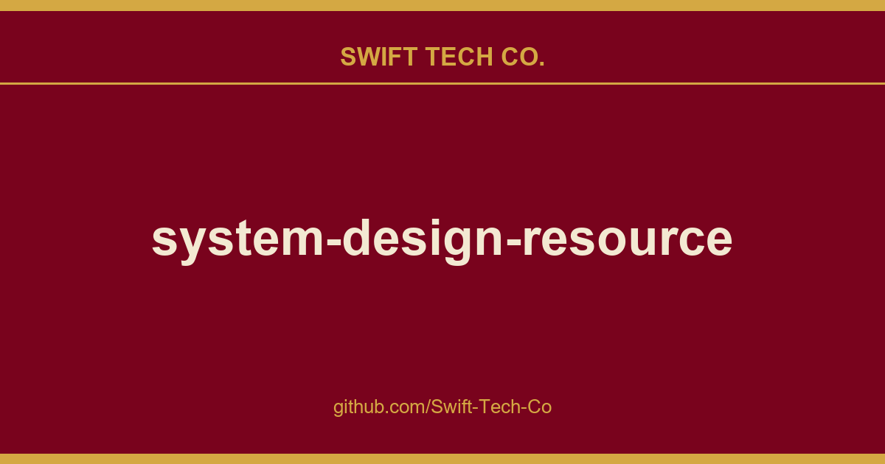

# system-design-resources

## What This Is

Every project needs a shelf of ready answers. product and engineering is one of those shelves, and system-design-resources is the entry on it - the notes, patterns and fixes we reuse when this kind of work comes up.

## Images

## Video Processing
- Transcoding Videos at Scale
- Facebook Video Broadcasting
- Netflix Video Encoding at Scale
- Netflix Shot based encoding

##
## Cluster and Workflow Management
- Facebook Cluster Management
- Google Autopilot - Autoscaling
- Netflix Workflow Orchestration
- Opensource Workflow Management
- Meta Hardware Management
- Meta Capacity Assignment
- Amazon EC2

##
## Intra-Service Messaging
- What is a message queue
- AirBnb Idempotency
- Meta Async Task Computing

## Message Queue Antipattern
- DB as queue Antipattern
- Using a database as a message queue
- Anti-pattern of DB as a queue
- Drawbacks of DB as a queue

##
## Service Mesh
- Kubernetes Service Mesh
- Kubernetes Sidecar
- Service Mesh
- NginX Service Mesh
- Data Plane and Control Plane

##
## Practical System Design
- Facebook Messenger Optimisations
- YouTube Architecture
- YouTube scalability 2012
- Distributed Design Patterns
- Monolith to Microservice
- Zerodha Tech Stack

##
## Distributed File System
- Open Source Distributed File System
- Amazon S3 Performance hacks
- Amazon S3 object expiration

##
## Time Series Databases
- Pinterest Time Series Database
- Uber Time Series DB
- TimeSeries Relational DB
- Facebook Gorilla Time Series DB

##
## Rate Limiting
- Circuit Breaker Algorithm
- Uber Rate Limiter

##
## In Memory Database - Redis
- Redis Official Documentation
- Learn Redis through Redis University
- Redis Open Source Repo
- Redis Architecture

##
## Network Protocols
- What is HTTP
- QUIC Protocol
- TCP Protocol algorithms (First 10 pages are important)
- WebRTC
- WebSockets
- Dynamic Source Routing using QUIC

##
## Chess Engine Design
- Chess Engine Building

##
## Subscription Management System
- Subscription Manager

##
## Google Docs
- Operational Transform
- Google Docs
- Lumiere

## 
## API Design

- API Design at Airbnb
- Swagger APIs

##
## NoSQL Database Internals

- Cassandra Architecture
- Google BigTable Architecture
- Amazon Dynamo DB Internals
- Design Patterns in Amazon Dynamo DB
- Internals of Amazon Dynamo DB

##
## NoSQL Database Algorithms

- Hyperloglog Algorithm
- Log Structured Merge Tree
- Sorted String Tables and Compaction Strategies
- Leveled Compaction Cassandra
- Scylla DB Compaction
- Indexing in Cassandra

##
## Database Replication

- Database replication
- Netflix Data replication - Change Data Capture
- LinkedIn Logging Usecases
- Uber Trillions of indexes in LedgerStore

##
## Containers and Docker

- Facebook Twine Containerization
- CloudFlare Containerization
- Docker Architecture

##
## Capacity Estimation

- Google Capacity Estimation
- Scalability at YouTube 2012
- Back of envelope Calculations at AWS
- Capacity Estimation

##
## Publisher Subscriber

- Oracle Publisher Subscriber
- Amazon Pub Sub Messaging
- Asynchronous processing
- Async Request Response

##
## Event Driven Architectures

- Martin Fowler- Event Driven Architecture
- Event Driven Architecture

##
## Software Architectures

- Hexagonal Architecture
- Hexagonal architecture (Alistair Cockburn)
- The Clean Code by Robert C. Martin (Uncle Bob)
- CQRS
- DomainDrivenDesign

##
## Microservices

- Monolith Architecture
- Monoliths vs Microservices
- Microservices
- Uber Nanoservices antipattern
- Uber Domain oriented microservice

##
## Distributed Transactions consistency Patterns

- Transactional outbox
- SAGAS Long lived transactions (LLTs)

##
## Load Balancing

- Load Balancer with Sticky Sessions
- NetScaler what is load balancing
- Nginx Load Balancing
- Consistent hashing
- Minimizing connection churn
- Google Subsetting Algorithm

##
## Alerts and Anomaly Detection

- Outlier Detection
- Anomaly Detection
- Uber Real Time Monitoring and Root Cause Analysis Argos
- Microsoft Anomaly Detection
- Facebook Data Engineering
- LinkedIn Real Time Alerting
- LinkedIn Isolation Forests

##
## Distributed Logging

- Uber Distributed Request Tracing
- Pintrest Logging
- Google Monitoring Infrastructure

##
## Metrics and Text Search Engine

- Facebook real-time text search engine
- Elastic Search Time Based Querying
- Elastic Search Aggregation

##
## Single Point of Failure

- Avoiding Single Points of Failure
- Netflix Multi-Region Availability
- Oracle Single Points of failure
- DNS single point of failure 2004
- DNS traffic management by Shopify
- Sharding

##
## Location Based Services

- Google S2 library

##
## Batch Processing

- Map Reduce Architecture

##
## Real Time Stream Processing

- LinkedIn Brooklin- Real-time data streaming
- Netflix Real Time Stream Processing
- KSQLDB for Kafka
- Netflix Psyberg

##
## Caching

- Google Guava Cache
- Caching (See the README)
- Caching
- Microsoft Caching Guide)
- Caching patterns
- Uber's Integrated Cache for 40M RPS

##
## Distributed consensus

- Paxos
- Raft

##
## Authorization

- Designing an Authorization Model for an Enterprise
- The Architectural Patterns of Cloud-native Authorization Systems

##
## Content Delivery Network

- AWS CloudFront CDN with S3

##
## Testing Distributed Systems

- Deterministic Testing
- TLA+ by Leslie Lamport
- Jepsen

##
## System Design Resources

- Designing Data-Intensive Applications Book
- WhitePapers
- InterviewReady Videos
- System Design Online Judge

---

## Swift Tech Co.

Built and maintained by Swift Tech Co.

AI Automation | FinTech Platforms | Custom Software and Mobile Apps | SaaS Platforms | Cloud Infrastructure | Cybersecurity | SEO and Marketing | API Integration

**Join our community on Telegram:** [t.me/+Qt_eFvkb2rliMzNh](https://t.me/+Qt_eFvkb2rliMzNh)

Home | Services | Careers | Referral Program | Influencers | About | Contact

**Connect**

- Website: https://github.com/Swift-Tech-Co/system-design-resources
- LinkedIn: [linkedin.com/in/stephenoladoke](https://www.linkedin.com/in/stephenoladoke/)
- LinkedIn (Company): [linkedin.com/company/swift-tech-co](https://www.linkedin.com/company/swift-tech-co)
- X: [@MrOladoke](https://x.com/MrOladoke)
- Instagram: [@mr.oladoke](https://www.instagram.com/mr.oladoke/)
- Organization: [github.com/Swift-Tech-Co](https://github.com/Swift-Tech-Co)

## Sources

Compiled and maintained from upstream [InterviewReady/system-design-resources](https://github.com/InterviewReady/system-design-resources) under permissive open-source license.

---

Maintained by [Swift Tech Co.](https://github.com/Swift-Tech-Co) - [Telegram](https://t.me/+Qt_eFvkb2rliMzNh)

## Sources

Compiled and maintained from upstream [InterviewReady/system-design-resources](https://github.com/InterviewReady/system-design-resources) under permissive open-source license.

---

Maintained by [Swift Tech Co.](https://github.com/Swift-Tech-Co) - [Telegram](https://t.me/+Qt_eFvkb2rliMzNh)

## Sources

Compiled and maintained from upstream [InterviewReady/system-design-resources](https://github.com/InterviewReady/system-design-resources) under permissive open-source license.

---

Maintained by [Swift Tech Co.](https://github.com/Swift-Tech-Co) - [Telegram](https://t.me/+Qt_eFvkb2rliMzNh)